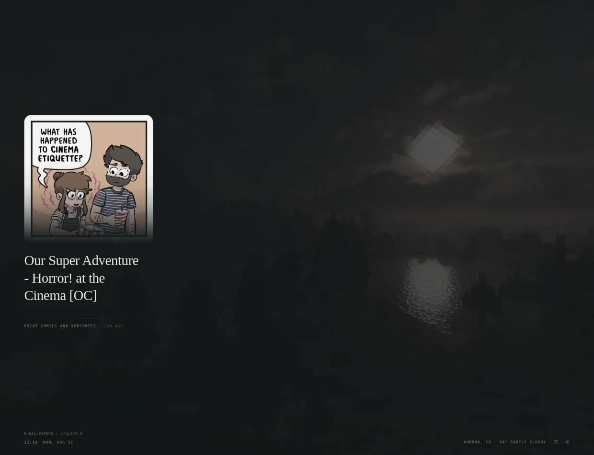
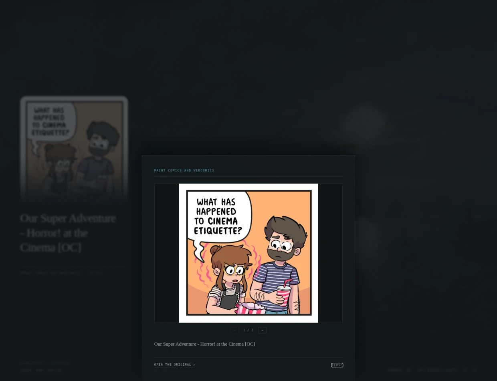

# Vitrine

A new tab that shows one thing worth looking at, plus an optional second card
from feeds you choose. The main piece is an idea, a short passage, or a figure
drawn on the spot. Everything rotates on a timer you set, and you can push it
along by hand whenever you like.

Click the piece to read the note behind it.



---

## Install

Vitrine is written in TypeScript, so there is one build step before the
browser can load it. You need [Node](https://nodejs.org) 18 or newer.

```sh
npm install
npm run build      # writes dist/
```

1. Keep this folder somewhere you will not delete it. The extension runs from
   these files, so moving or removing the folder breaks it.
2. Go to `chrome://extensions`. In Brave that is `brave://extensions`, in Edge
   `edge://extensions`, and so on for any other Chromium browser.
3. Turn on **Developer mode**, top right.
4. Click **Load unpacked** and choose the **`dist`** folder — not the repo
   root. `dist` is the built extension.
5. Open a new tab. The browser will ask once whether to keep the new page. Say
   yes.

To pick up an edit: run `npm run build` again, then hit reload on the Vitrine
card on the extensions page. `npm run watch` rebuilds on save, so you only
need the reload.

---

## Working on it

```
src/        TypeScript. src/newtab.ts is the entry point.
static/     The half that is not code: newtab.html, manifest.json, css, icons.
dist/       The built extension. Disposable — this is what Chrome loads.
test/       Node's own test runner, driving the real bundle.
```

| | |
|---|---|
| `npm run build` | Bundle `src/` and copy `static/` into `dist/` |
| `npm run watch` | The same, rebuilding whenever a file is saved |
| `npm run check` | `tsc --noEmit` — types only, no output |
| `npm test` | Build, then run everything in `test/` |
| `npm run package` | Check, build minified, and zip `dist/` for the store |

The modules are layered so nothing imports in a circle: `base` sits at the
bottom, `settings` holds state and knows nothing about the UI, and `newtab`
is the only module that reaches for all of them. The settings panel is handed
the page's refresh functions rather than importing them, which is what keeps
it from having to know what a new tab is.

Types are on their strictest setting, including `noUncheckedIndexedAccess`
and `exactOptionalPropertyTypes`. There are no `any`s and no non-null
assertions in `src/`.

The tests run the real bundle in a stub document, with only the network and
the DOM faked. They are there for what a type checker cannot see: that a new
tab paints from cache and then holds still, that a feed which fails falls back
to the last good fetch, and that `newtab.html` and `base.ts` still agree about
what is in the page.

---

## Using it

| | |
|---|---|
| Click the piece | Read the note, or open the pictures |
| **↻** in the corner | Show something else, right now |
| `→` / `←` | Same, from the keyboard |
| `→` / `←` with a gallery open | Step through the pictures |
| `,` | Open settings |
| Click the weather | Open settings, where the location lives |
| `Esc` | Close whatever is open |

The ↻ button moves the piece, the card, and the backdrop on together, whatever
their individual clocks say. It does not reset those clocks; the next scheduled
change still lands when it was going to, just further along.

---

## Feeds

Settings → **Feeds**. Paste `reddit.com/r/AskHistorians` and it will work out
the `.rss` for you. Any RSS or Atom URL is fine too. Vitrine reads the feed
once to confirm it is real, then adds it under its own name.

The first time you add a feed from a given site, the browser asks whether to
let Vitrine read that site. It only ever requests the specific sites you add,
plus the `www.` and bare-domain variants of each, since a redirect between the
two crosses an origin boundary and would otherwise void the permission
mid-request. Reddit URLs are rewritten to `www.reddit.com` up front so that
redirect never happens at all.

Feeds saved before that fix are rewritten on the next new tab, so there is no
need to remove and re-add one.

**How often it changes** is set under Rotation → Second card. By default it is
a different item on every new tab.

**Where feed items go.** Three choices:

- **Second card** *(default)*. Feed items take the main slot and one more sits
  below it. Two things on screen, never more, and never the same item twice.
- **In rotation.** The main slot only. One thing on screen.
- **Off.** Feeds are kept but nothing from them is shown.

**The collection steps back.** With no feeds added, all forty bundled pieces
are in rotation and one is always on show. The moment a feed starts returning
items, the collection drops to roughly one slot in five and the feeds take the
rest. Nothing is lost from the collection, since the piece slots still stride
the whole forty before repeating any, but each piece now comes round five times
more slowly. That is what keeps the bundled writing from going stale next to
things that are actually new. Turn feeds **Off** and the collection takes every
slot again.

Feeds refresh every half hour, or on demand from **Refresh feeds now**. If a
feed is unreachable the last good copy stays up instead of the card vanishing.

Feeds that update many times an hour will crowd out the quieter ones, since
items are ordered by time. A few narrow feeds work better here than one busy
one.

### Pictures from a feed

Feed items carry their picture through. A thumbnail sits beside the headline on
the second card; in the main slot the image runs above it. Vitrine prefers the
large image in the post body over the small `media:thumbnail` Reddit also
sends, falls back to the post's own link when that link is itself a photograph,
and skips Reddit's `self` and `nsfw` placeholders. Posts with no image just
show the headline.

**Images only.** Each feed in the list carries an *Images only* toggle. Turn it
on and that feed contributes nothing but its posts with a picture; text posts
are dropped before they ever reach the rotation. It is for the subreddits you
keep for looking rather than reading, where a self post is a gap in the wall.
Twelve items are still taken from such a feed, reading as far as sixty posts
down to find twelve with a picture, so an image-only feed carries the same
weight in the rotation as any other. The summary goes too, since on those posts
it is only Reddit's own scaffolding: who submitted it, where to comment. The
picture says the rest. Toggling it re-reads the feed straight away instead of
waiting for the half-hour refresh.

**Full size, not thumbnail size.** What Reddit puts in a feed is a signed crop,
and for a gallery post that crop is 140 pixels across. The same file unsigned
at `i.redd.it` is the original the poster uploaded, so an image-only feed asks
for that instead, on the card as well as in the viewer. That is the trade: a
looking feed spends more bytes per picture than a reading one, which is rather
the point of marking it. Reddit does not have an original behind every crop
(the poster frame of a video, for one), so the crop that was definitely there
stays behind it as a fallback and gets shown if the full-size file comes back
missing.

A picture too small to fill the frame may double in size and no more, which is
the difference between a stamp in a lot of air and a blur.

One case is dropped that arguably should not be. A gallery post with a written
body gets no thumbnail at all from Reddit, so there is nothing to put on the
card and the item goes. It costs a couple of posts in a typical r/comics
window.

### The viewer

An item from an image-only feed opens onto its pictures instead of onto a note.
Click the piece, or press Enter, and the sheet comes up with the image in it at
size, in full colour, the headline underneath as a caption. The card behind it
does not change.



If the post is a Reddit gallery the sheet is a carousel. Reddit's feed sends
only the first picture and a link, so the rest are asked for when the sheet
opens: one small request per post, then remembered, so opening it again is free
and nothing at all is fetched on an ordinary new tab. The strip fills in under
your hand instead of making you wait on it. Move through it with the arrow
keys, the two buttons under the frame, a trackpad swipe, or by clicking the
picture. The count says where you are, and once a gallery has been opened the
cue under the piece knows how many are in there and says so.

Reddit throttles that request sometimes, and has been tightening the endpoint
for years. When it refuses, the sheet says so under the frame and shows the one
picture the feed sent. **Open the original** still goes to the whole post. The
same line says what is going on while the asking is still in progress.

Full size is a link away either way. The frame is a little under half the
window, which makes it a look rather than a read for a tall comic.

The second card is unchanged too. It is a link, and clicking it opens the post
on Reddit, which has its own gallery.

### How pictures are hung

Photographs sit in a pool of ground colour, so the image always meets the ink
and not whatever backdrop happens to be behind it.

**Image edges.** *Dissolve* fades the bottom edge out under the headline.
*Framed* gives it a hairline border instead, with its foot settled into the
ground so the photograph does not stop dead square. Only the bottom is treated
either way. Fading all four sides looks good on a landscape that runs to its
own edges and bad on anything with a subject in the middle, which is most of
what a feed will hand you.

**Image treatment** controls the colour:

- **Plain.** The photo as it was taken.
- **Muted** *(default)*. Saturation cut, brightness barely touched, so it sits
  with the rest of the page instead of shouting over it. Dark images on a dark
  ground have little left to give, so this desaturates rather than dims.
- **Duotone.** Greyscaled and washed in the piece's own tint, the way the drawn
  plates are. Strongest match to the theme, least faithful to the photo.

Hovering the piece returns any treated image to full colour, so the page stays
quiet at rest and gives you the real photograph when you look at it.

Pictures are hung to a common height rather than a common width, the way prints
are hung on a wall. Nothing is cropped: a portrait stays a portrait, a panorama
stays a panorama, and the width follows from the shape of the picture. A
ceiling of 380px, or 42% of the window, keeps a tall one from swallowing the
page, and less than that on a short window so the cue never gets clipped off
the bottom.

That shape is not known until the picture arrives, so the plate opens at a
plain 3:2 and eases to the real proportions as the image fades up, carrying the
headline under it along instead of kicking it. A picture with too few pixels
to fill the plate makes the plate smaller instead of being enlarged to fit, and
one that fails to load folds the plate away instead of snatching it back.

If you run a photo backdrop and an image-heavy feed at once, the ground pool
keeps the two layers apart, and *Framed* edges separate them more firmly still.
To give pictures more or less room, change `--cap` on `.figure` in
`static/css/vitrine.css`. `AR_MIN` and `AR_MAX` in `src/newtab.ts` are the
shapes past which something is treated as a banner and not a photograph.

---

## Backdrops

Settings → **Backdrop**. Five sources:

- **Ambient** *(default)*. Two slow blurred glows, tinted to match whatever
  piece is on show, drifting on a three-minute cycle. Drawn in CSS, needs no
  network, never fails.
- **NASA.** The Astronomy Picture of the Day. Works out of the box on NASA's
  shared demo key, which is rate-limited across everyone using it; a free key
  from `api.nasa.gov` removes that. Vitrine fetches once every twelve hours. If
  the day's entry is a video it uses the still NASA provides.
- **Unsplash.** Needs a free Access Key from `unsplash.com/developers`. Make an
  app there and copy the key in. An optional search term narrows it. Pulls 24
  landscape photos at a time and credits the photographer.
- **Reddit.** One subreddit per line. Pulls from hot and credits the poster.
  **Minimum width** is yours to set: *Any* takes every image post and stretches
  it to fill the screen, *800px* and *1200px* filter first. Any is the default.
  A small image blown up to fill a monitor is soft, but it is dimmed and
  desaturated behind the veil anyway, so it often reads fine. Your call, not
  the extension's.
- **Your own.** Paste image URLs, one per line. Nothing is fetched but the
  images themselves, so this one works when everything else is blocked.

**Dim the photo** controls how hard the image is pushed back behind the text:
light, medium, or heavy. Photos are also desaturated and darkened before the
dimming so they read as ground and not as wallpaper. Busy or bright images want
heavy.

**Test this source** fetches immediately and tells you what happened: how many
images it found, or the specific reason it failed. Use it after pasting a key
or a subreddit, instead of waiting to see whether the next tab looks
different.

If a source fails at any point, the ambient glow comes back and the page never
goes blank.

---

## Settings

**Layout.** Alignment left or centred, and three text sizes. Left is the
default and holds at every window width.

**Rotation.** Three separate clocks, because the three things on screen do not
want the same one:

| | |
|---|---|
| **Main piece** | Tab, 1h, 3h, 6h, or Day |
| **Second card** | Every tab, or with the piece |
| **Backdrop** | Tab, 1h, 6h, or Day |

The defaults are a card that changes on every new tab, a piece that holds for
three hours, and a backdrop that holds for six, so a new tab feels fresh
without the whole page churning. Set any of them to **Tab** to have it change
on every load, or to **Day** to have it hold until tomorrow.

The second card walks your feed in time order, newest first and wrapping at the
end, so a run of tabs reads down the list instead of jumping around.

A new tab paints itself from the last fetch before it goes looking for a newer
one, and then holds still: whatever came up stays up, even if the fetch that
lands a moment later would have chosen differently. A page that reshuffles
itself under your eye a second after loading reads as a fault. The fresher
list is waiting for the next tab.

The ↻ button ignores all of this and moves everything on at once.

**Weather.** °F or °C, and a location that accepts a city name, a US ZIP, a
Canadian or UK postcode, or something like `Kyoto, JP`.

**Reset everything** at the foot of the panel restores the defaults and clears
your feed list.

---

## Making it yours

**Adding pieces.** The collection lives in `src/pieces.ts`. Copy an entry,
replace the words, and run the build:

```ts
{
  kind:  'note',            // 'note', 'passage', or 'plate'
  lead:  'What appears large, under the glass.',
  label: { field: 'Field · Subject', date: '1843' },
  note:  'The longer text, revealed on click. Blank lines start new paragraphs.',
  link:  { text: 'Where to go next', url: 'https://…' },
  tint:  TINT.indigo        // the colour the ambient ground takes on
}
```

`note` pieces get a reading size, `passage` pieces are set large. Both are
plain text, no HTML. Miss a field, or name a plate that does not exist, and
`npm run check` will say so rather than the page going blank.

**Colours.** The palette is at the top of `static/css/vitrine.css`. `--ink` is
the ground, `--chalk` the text. Piece tints are the `TINT` table in
`src/pieces.ts`. Feed items borrow a tint from a hash of their source name, so
a given subreddit always lights the ground the same colour.

**Plates.** `src/plates.ts` holds six figures drawn with the Canvas API: a
sunflower head, Chladni nodal figures, the Venus rosette, an angular
unconformity, a dome on pendentives, and a branching network. Each is a
`PlateFn` — `(ctx, w, h, ink, rng)`. Add one to `PLATES` and reference it by
name in a piece with `kind: 'plate'` and `draw: 'yourFunction'`; the name is
checked against what is actually there.

**Using real images.** Drop files into `static/images/` and, in `show()` in
`src/newtab.ts`, handle a new kind that builds an `` instead of a canvas.
The wall label and note work the same way.

---

## What it talks to

- `open-meteo.com` for the current conditions, and for city-name lookups.
- `zippopotam.us` when you type a postcode instead of a city.
- Whatever feed sites you add.
- `reddit.com`, once per gallery post whose viewer you open, for the rest of
  that post's pictures. It is the same site the feed came from, so it needs no
  permission beyond the one you already gave that feed, and it is never asked
  on a plain new tab.
- Whichever backdrop source you pick, and only that one. On Ambient it talks to
  nothing at all.

Each is requested as a permission when you first enable it, not up front.

No account, no key, no analytics. Weather readings are cached for twenty
minutes, feed items for thirty, and the contents of a gallery for as long as it
stays among the last eighty opened. Cached items carry a shape number, so a
version that adds a field to them will not go on being served a cache written
before that field existed.

Feed bodies are parsed, not assigned into the page. Assigning them, even
to an element that is not in the document, starts a download for every image in
every item: two dozen pictures a refresh that nobody was going to look at.

The collection itself is bundled locally, so with the network off the page
still works. The weather line says so and the second card falls back to its
last copy.

Your settings, feed list, and place in the deck are kept in the browser's local
storage on your own machine. Both the settings and the caches carry a shape
number, so a version that changes what is stored falls back to its defaults
rather than half-reading what the previous one wrote. If a new tab cannot draw
at all, it throws the stored settings away and tries once more on the defaults:
the way back to the settings panel is through the page, so a page that will not
open is not allowed to be the end of it.

---

## Built with AI assistance

Vitrine was co-written with Claude. The shape of it, the design calls, and the
code all came out of that back and forth. It has been run and looked at, but
take it for what it is: a personal project, not audited code.
